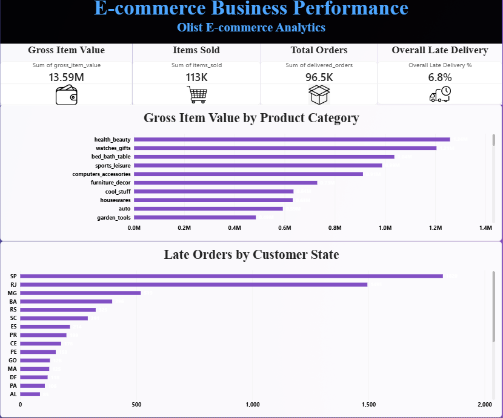
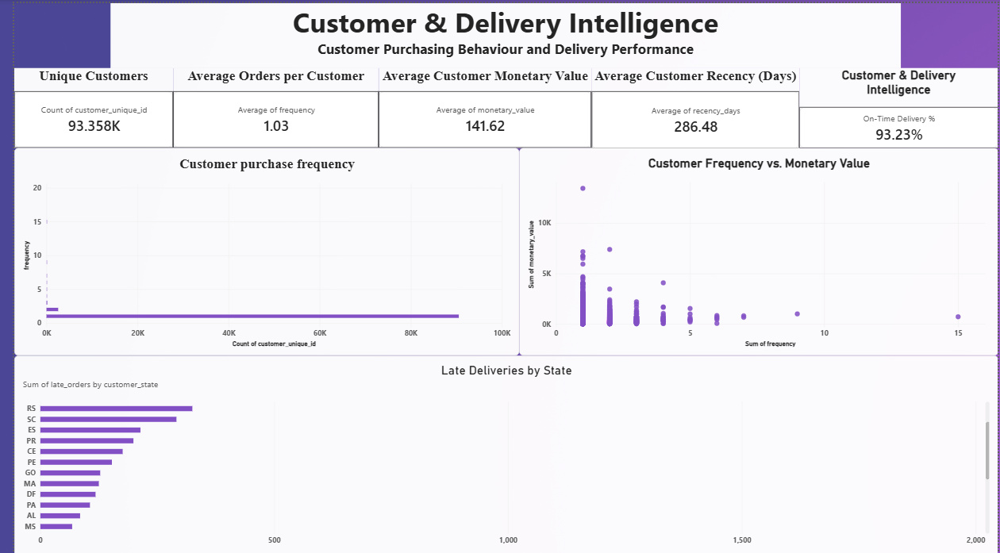

# Olist E-commerce Data Analytics

An end-to-end analytics project using **Python, MySQL, Excel, and Power BI** to investigate business performance, product trends, delivery operations, customer satisfaction, customer behavior, and seller performance in the Olist Brazilian e-commerce dataset.

<p align="center">
  <strong>End-to-end workflow</strong><br/>
  Python · MySQL · Excel · Power BI
</p>

## Dashboard Preview

The Power BI report contains two pages. Select either screenshot to open the full-size image.

<table>
  <tr>
    <td align="center" width="50%">
      <strong>Page 1 — Business Performance Overview</strong><br/><br/>
      <a href="powerbi/screenshots/dashboard_page_1.png.png">
        
      </a>
    </td>
    <td align="center" width="50%">
      <strong>Page 2 — Customer and Operational Analytics</strong><br/><br/>
      <a href="powerbi/screenshots/dashboard_page_2.png.png">
        
      </a>
    </td>
  </tr>
</table>

**[Open the Power BI folder](powerbi/README.md)** · **[View the PBIX report](powerbi/Olist_Ecommerce_Business_Performance.pbix)**

## Project Overview

This project analyzes the Olist Brazilian E-commerce Public Dataset to identify business patterns and generate actionable insights from transaction data.

The work covers the analytical lifecycle: data inspection, cleaning, validation, SQL analysis, Excel reporting, dashboard development, and consolidation of business findings.

## Business Objectives

- Evaluate revenue and overall business performance.
- Identify top-performing product categories.
- Analyze delivery efficiency and late-delivery patterns.
- Understand the relationship between delivery performance and customer reviews.
- Segment customers based on purchasing behavior using RFM analysis.
- Evaluate seller performance using revenue, order volume, delivery, and review metrics.

## Dataset

**Source:** Olist Brazilian E-commerce Public Dataset.

The project uses nine related datasets:

- Customers
- Orders
- Order Items
- Products
- Sellers
- Payments
- Reviews
- Geolocation
- Product Category Translation

The original dataset contains approximately 100,000 orders and related customer, product, payment, seller, and review information.

> Raw dataset files are not included in this repository. Obtain the public dataset separately before reproducing the analysis.

## Technology Stack

| Technology | Purpose |
|---|---|
| Python | Data inspection, cleaning, validation, and exploratory analysis |
| Pandas & NumPy | Data manipulation and preprocessing |
| Matplotlib | Data visualization |
| MySQL | Data storage, SQL analysis, views, and business queries |
| Microsoft Excel | Analytical reporting, pivot-based analysis, and charts |
| Power BI | Interactive dashboards, data modeling, Power Query, and DAX |
| Google Colab / Jupyter Notebook | Python development environment |
| MySQL Workbench | Database management and SQL development |

## Project Workflow

1. **Data Understanding:** Inspected source datasets, dimensions, data types, and relationships.
2. **Data Cleaning:** Identified missing values, duplicates, invalid records, and category inconsistencies using Python.
3. **Database Preparation:** Loaded datasets into MySQL and performed validation checks.
4. **SQL Analysis:** Created analytical queries and reusable views to investigate business performance.
5. **Excel Analysis:** Developed analytical worksheets, summaries, and charts.
6. **Power BI Development:** Built interactive dashboards with KPIs, visualizations, slicers, and data models.
7. **Business Insights:** Consolidated findings across six business analysis areas.

## Business Analysis Areas

### 1. Revenue and Business Performance
- Product revenue and freight analysis.
- Monthly revenue trends.
- Order volume and average order value.
- Month-over-month revenue growth.

### 2. Product and Category Performance
- Revenue contribution by product category.
- Top-performing categories.
- Category-level order and item analysis.
- Identification of unknown or missing category classifications.

### 3. Delivery and Logistics
- Average delivery time.
- Estimated versus actual delivery performance.
- On-time and late delivery analysis.
- Monthly delivery trends.

### 4. Customer Satisfaction
- Review score analysis.
- Comparison of customer ratings across delivery outcomes.
- Delivery experience and customer satisfaction patterns.

### 5. Customer Segmentation
- RFM-based customer segmentation.
- Customer purchase frequency and monetary value.
- Customer segment contribution to revenue.
- Identification of customers requiring retention or re-engagement.

### 6. Seller Performance
- Seller revenue and order volume.
- Items sold and freight contribution.
- Delivery performance.
- Seller-level customer review analysis.

## Key Business Findings

The following findings are based on the completed analysis:

| Metric | Finding |
|---|---:|
| Unique orders | 99,441 |
| Product revenue | ₹1.36 Crore |
| Freight value | ₹22.52 Lakh |
| Total order value | ₹1.58 Crore |
| Product categories | 73 |
| Customers in RFM analysis | 96,096 |
| Sellers analyzed | 3,095 |
| Valid delivered orders in monthly delivery analysis | 96,470 |

### Selected Insights

- November 2017 recorded the highest monthly product revenue, approximately ₹10.10 lakh.
- The top 10 product categories contributed approximately 62.36% of total product revenue.
- In the monthly delivery analysis, 91.89% of valid delivered orders were classified as on time.
- On-time deliveries had an average review score of approximately 4.29, compared with 2.57 for late deliveries.
- The Champions customer segment represented approximately 6.98% of analyzed customers and contributed 13.64% of revenue.
- The top 10 sellers by product revenue contributed approximately 13.15% of total product revenue.

**Analysis note:** Delivery-related figures vary between certain analysis outputs because their underlying populations or classification results differ. The delivery figures above are reported from their respective analyses and have not been presented as one reconciled metric.

For the complete interpretation and limitations, see [Consolidated Business Insights](docs/business_insights.md).

## Project Files

| Component | Description |
|---|---|
| [Python](python/README.md) | Data cleaning, validation, and exploratory analysis |
| [Python Notebook](python/notebooks/olist_ecommerce_data_analysis.ipynb) | Main Python analysis notebook |
| [MySQL](sql/README.md) | Database preparation, SQL queries, and analytical views |
| [Excel](excel/README.md) | Excel analysis and reporting |
| [Excel Workbook](excel/Olist_Excel_Analytics.xlsx) | Analytical worksheets and charts |
| [Power BI](powerbi/README.md) | Dashboard documentation and screenshots |
| [Power BI Report](powerbi/Olist_Ecommerce_Business_Performance.pbix) | Interactive Power BI report |
| [Business Insights](docs/business_insights.md) | Consolidated findings from all six analysis areas |
| [Data Dictionary](docs/data_dictionary.md) | Dataset and field documentation |
| [Project Workflow](docs/project_workflow.md) | Project process and analytical workflow |

## Repository Structure

```text
olist-ecommerce-data-analytics/
├── README.md
├── data/
│   └── README.md
├── python/
│   ├── notebooks/
│   │   └── olist_ecommerce_data_analysis.ipynb
│   ├── scripts/
│   └── README.md
├── sql/
│   ├── table_creation/
│   ├── data_import/
│   ├── data_validation/
│   ├── business_analysis/
│   ├── views/
│   └── README.md
├── excel/
│   ├── Olist_Excel_Analytics.xlsx
│   └── README.md
├── powerbi/
│   ├── Olist_Ecommerce_Business_Performance.pbix
│   ├── screenshots/
│   │   ├── dashboard_page_1.png.png
│   │   └── dashboard_page_2.png.png
│   └── README.md
└── docs/
    ├── business_insights.md
    ├── data_dictionary.md
    └── project_workflow.md
```

## How to Explore the Project

1. Review the Python notebook to understand the data preparation process.
2. Explore the SQL folder for database scripts, analytical queries, and views.
3. Open the Excel workbook to review the worksheets and charts.
4. Open the Power BI report in Power BI Desktop to explore the dashboards.
5. Read the consolidated business insights to understand the findings.

To reproduce the analysis, obtain the original Olist public dataset, prepare the database, and configure the relevant data sources and file paths for your environment.

## Skills Demonstrated

- Data Cleaning and Preprocessing
- Exploratory Data Analysis
- SQL Queries, Joins, CTEs, Subqueries, and Views
- Data Validation
- Business and KPI Analysis
- Excel Reporting and Data Visualization
- Power BI Dashboards
- Data Modeling and DAX
- Customer Segmentation using RFM Analysis
- Business Insight Generation

## Author

**Sharun Satheesh**

Aspiring Data Analyst | Python | SQL | Excel | Power BI

[GitHub](https://github.com/sharunsha) · [LinkedIn](https://www.linkedin.com/in/sharunsatheesh/)

---

*This project was developed for practical learning and portfolio demonstration using publicly available e-commerce data.*
