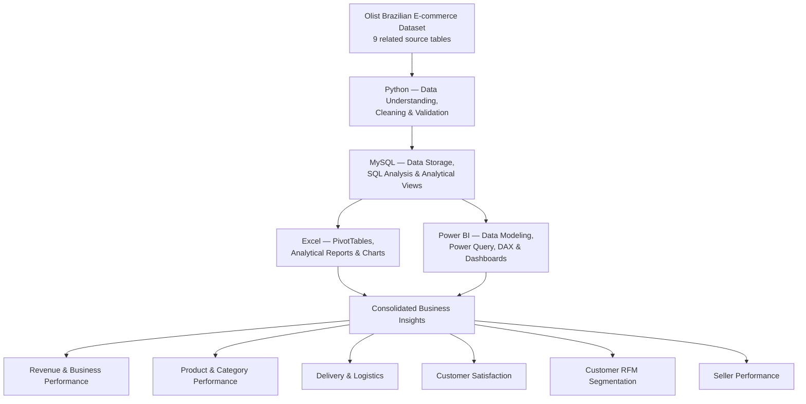

# Olist E-commerce Analytics — Project Architecture

This diagram summarizes the tools and analytical stages documented in this repository. Excel and Power BI are shown as parallel reporting outputs rather than as sequential processing steps.

## Architecture diagram

## Stage descriptions

| Stage | Tools | Purpose |
|---|---|---|
| Source data | Olist public dataset | Provides order, customer, product, seller, payment, review, geolocation, and category information. |
| Data preparation | Python, Pandas, NumPy | Inspects, cleans, validates, and prepares the source data. |
| Database and analysis | MySQL | Stores the prepared data and supports SQL queries, analytical views, and business analysis. |
| Spreadsheet reporting | Microsoft Excel | Presents analysis through worksheets, PivotTables, summaries, and charts. |
| Interactive reporting | Power BI, Power Query, DAX | Models the data and presents KPIs and interactive dashboard pages. |
| Business interpretation | Consolidated analysis | Brings together findings across six business areas. |

## Analytical outputs

The project investigates six areas:

1. Revenue and business performance
2. Product and category performance
3. Delivery and logistics
4. Customer satisfaction
5. Customer segmentation using RFM analysis
6. Seller performance

## Related project resources

- [Main project README](../README.md)
- [Python documentation](../python/README.md)
- [SQL documentation](../sql/README.md)
- [Excel documentation](../excel/README.md)
- [Power BI documentation and dashboard previews](../powerbi/README.md)
- [Consolidated business insights](business_insights.md)

---

*The diagram represents the documented project workflow at a high level. It does not imply that every report is refreshed automatically or that the tools form a live production pipeline.*
