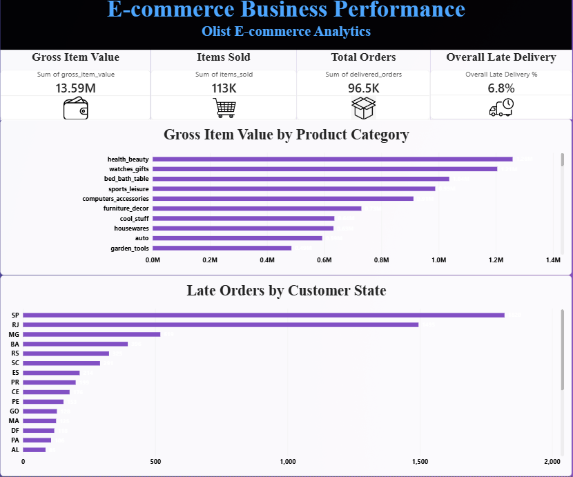
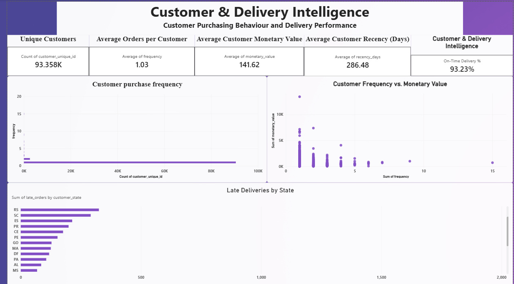

# Power BI — Olist E-commerce Analytics

This folder contains the Power BI report and its dashboard screenshots for the Olist E-commerce Data Analytics project.

## Report

**File:** [Olist_Ecommerce_Business_Performance.pbix](Olist_Ecommerce_Business_Performance.pbix)

The report contains two dashboard pages.

## Dashboard Preview

### Page 1 — Business Performance Overview

Focus areas:
- Revenue and order performance
- Product and category analysis
- Key business performance indicators
- Revenue trends and comparisons

### Page 2 — Customer and Operational Analytics

Focus areas:
- Delivery and logistics performance
- Customer satisfaction
- Customer segmentation
- Seller performance

Select either screenshot to open the full-size image.

## Data Model

The report uses the Olist analytical dataset, with data sourced from these business entities:

- Orders
- Order Items
- Products
- Customers
- Payments
- Reviews
- Sellers
- Geolocation
- Category Translation

## Power BI Techniques

- Data modeling and table relationships
- Power Query and data transformation
- DAX measures and calculated KPIs
- Interactive visualizations
- Filters and slicers
- Cross-filtering and drill-down analysis

## Tools

- Microsoft Power BI Desktop
- Power Query
- DAX
